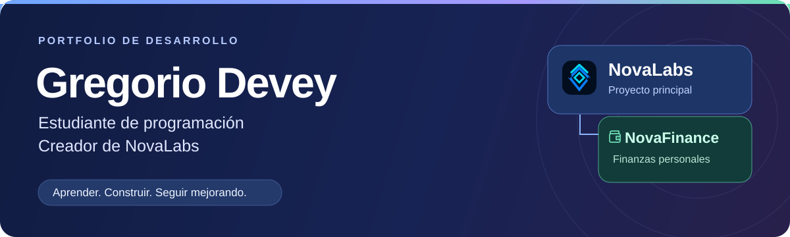

## Hola, soy Gregorio

Soy **Gregorio Devey**, estudiante de programación y desarrollador en formación. Aprendo construyendo proyectos personales: desde interfaces web hasta aplicaciones para organizar tareas y finanzas.

Creé **NovaLabs** para reunir ese trabajo, mostrar lo que voy desarrollando y documentar su evolución. Me interesa seguir aprendiendo y dar mis primeros pasos profesionales en programación.

[Conocé NovaLabs](https://github.com/gregoriodevey99-oss/NovaLabs-Portfolio) · [LinkedIn](https://www.linkedin.com/in/gregorio-devey/)

## NovaLabs · Mis proyectos

**NovaLabs es el proyecto principal.** Cada producto tiene su propia idea, sus tecnologías y un estado de desarrollo visible.

| Proyecto | Qué estoy construyendo | Estado |
| --- | --- | --- |
| **[NovaLabs Portfolio](https://github.com/gregoriodevey99-oss/NovaLabs-Portfolio)** | El sitio que presenta el ecosistema, con Python, Flask, HTML, CSS y JavaScript. | Código público y guía para ejecutarlo localmente. |
| **[NovaFinance](https://github.com/gregoriodevey99-oss/NovaLabs-Portfolio/blob/main/docs/novafinance.md)** | Aplicaciones de finanzas personales para Windows y celular. | Windows funcional de manera local. Móvil en desarrollo, probado con datos de demostración en Expo Go. |
| **NovaShop** | Catálogo, búsqueda, carrito y simulación de pedido. | Demostración incluida en NovaLabs Portfolio. |
| **NovaCore** | Inventario con altas, búsqueda y ajuste de stock. | Demostración con almacenamiento en el navegador. |
| **Nova AI · ADAM** | Un recorrido de asistente con opciones y respuestas predefinidas. | Demostración de interfaz; no está conectada a un modelo de IA. |

### En foco: NovaFinance

Estoy trabajando en una misma idea desde dos entornos:

- **Windows:** Python, Flask y SQLite, con funcionamiento local.
- **Móvil:** React Native y Expo, con secciones de inicio, movimientos, presupuesto y metas, además de modos claro y oscuro.
- **Próximos objetivos:** publicación en la nube, sincronización entre versiones y distribución de una aplicación móvil instalable.

La versión móvil usa datos de demostración. La publicación y la sincronización forman parte del trabajo pendiente.

## Tecnologías que uso en mis proyectos

| Área | Tecnologías y herramientas |
| --- | --- |
| Desarrollo web | Python · Flask · HTML · CSS · JavaScript |
| Datos locales | SQLite, en NovaFinance para Windows |
| Desarrollo móvil | React Native · Expo, en NovaFinance Móvil |
| Organización del trabajo | Git · GitHub · Visual Studio Code |

## Lo que estoy practicando

- Organizar el código en archivos con responsabilidades claras.
- Diseñar interfaces legibles y adaptables a distintos tamaños de pantalla.
- Construir interacciones y conectar las distintas partes de una aplicación.
- Explicar qué hace cada proyecto, cómo probarlo y qué queda por mejorar.

## Conectemos

[LinkedIn](https://www.linkedin.com/in/gregorio-devey/) · [Mis repositorios públicos](https://github.com/gregoriodevey99-oss?tab=repositories)

Gracias por pasar y conocer mi trabajo.
